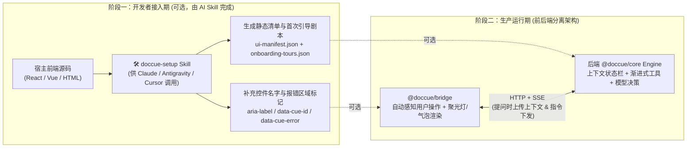
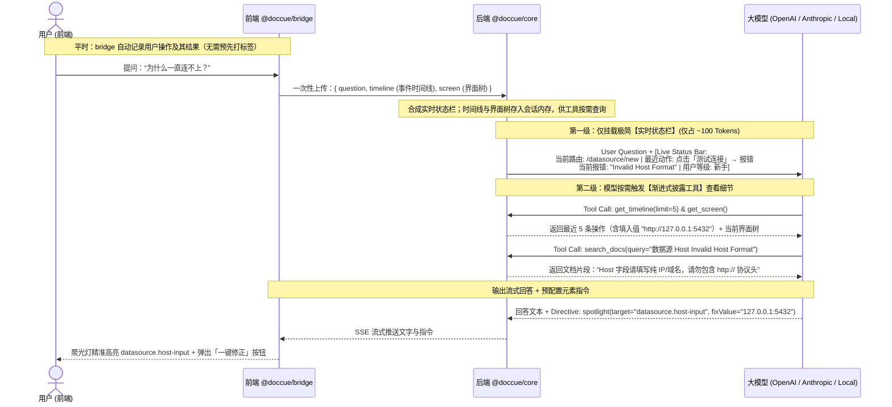

# DocCue 核心架构企划（v2.3）

> [!IMPORTANT]
> **项目名称**：**DocCue**（*Turn static docs into context-aware in-app cues.*）
> **核心定位与五大基石**：
> `DocCue` 具备两大核心使命——**① 首次进入软件/页面时的主动破冰引导（First-Time Onboarding）** 与 **② 遇到问题时的现场感知答疑（Contextual Q&A）**。
> `DocCue` 只提供一个**开箱即用的快捷 Agent**（接入 Skill + 前端 SDK + 后端 handler），不是完整的系统：鉴权、持久化、部署这类开发者系统里本来就有的能力不重复造，详见「零、范围边界」。
> 1. **后端大脑 + 前端“眼手”分离**：Agent 核心代码、Prompt 与文档 100% 驻留后端；引导剧本存放在后端、初始化时下发给前端执行；前端仅挂载极薄的传感与渲染桥接层（`@doccue/bridge`），让用户感觉 Agent “住在前端界面里”。
> 2. **零配置感知 + AI Skill 可选增强**：运行时由 bridge 自动从界面读出控件名字和用户操作（无埋点），不打标签也能工作；接入期 AI Skill（`doccue-setup`）只做增强：给自动命名不准的控件补名字、生成控件说明（`ui-manifest.json`）与首次引导剧本（`onboarding-tours.json`）、标记报错区域。
> 3. **双模首次引导（静态零消耗 + AI 千人千面定制）**：既支持开箱即用的 0 Token 静态首次引导，也支持根据用户角色/目标由 AI 动态生成专属新手引导流，且引导途中可随时提问、答完继续引导。
> 4. **“实时状态栏 + 渐进式披露”上下文管理**：最新一轮挂载极简**实时状态栏（Live Status Bar）**；完整事件时间线、界面树、截图、用户详细画像与文档，均由模型通过工具**渐进式按需查看（Progressive Disclosure）**。
> 5. **极致轻量 + 可替换**：0 第三方运行时重依赖（截图模块按需懒加载）；平时仅在本地静默记录用户操作，既不请求后端，也不做无意义弹窗打扰；扩展只靠配置项（模型适配器、文档检索、会话存储、自定义工具），不做通用插件框架。

---

## 零、 范围边界：我们做什么，不做什么

`DocCue` 只交付一个**快捷 Agent 套件**：接入 Skill + 前端 SDK + 后端 handler。开发者系统里本来就有的能力（登录鉴权、数据库、部署运维），我们不重复造，只留接口。

### ✅ 我们做

| 交付物 | 负责的事 |
| :--- | :--- |
| **`skills/doccue-setup`**（接入 Skill，可选） | 为自动命名不准的控件补 `aria-label` / `data-cue-id`，标记报错区域，生成 `ui-manifest.json`（控件说明）与 `onboarding-tours.json`。 |
| **`@doccue/bridge`**（前端 SDK） | 无埋点式感知用户操作（事件时间线、界面树、报错、按需截图）；首次引导（本地触发、跨页续引）；问答窗、聚光灯、引导气泡、一键代填。v1 支持网页与 Electron / Tauri / WebView 客户端。 |
| **`@doccue/core`**（后端 Agent） | Agent 循环、实时状态栏、渐进式披露工具、UI 指令协议、个性化引导编排、模型适配（OpenAI / Anthropic / 本地模型）；对外只暴露一个标准 HTTP/SSE handler。 |
| **`@doccue/docs`**（文档检索） | 方案 A：模型自主检索文档目录（默认）；方案 C：开发者传入自定义检索函数。 |
| **`apps/playground`**（演示） | 一个模拟 SaaS，演示完整链路。 |

### ❌ 不做（属于开发者自己的系统）

| 能力 | 开发者怎么接 |
| :--- | :--- |
| 登录鉴权、用户身份校验、限流、计费与额度 | handler 是标准的 `(Request) => Response` 函数，开发者把它挂在自己的路由和中间件后面。 |
| 用户数据持久化（引导进度跨设备同步、对话存档、行为分析） | 默认只用浏览器 localStorage 和后端进程内存；需要持久化时，在 bridge 初始化时传入已完成的引导列表、监听完成回调，自行存储。 |
| 部署、扩容、多实例共享会话 | 会话默认存在进程内存；多实例部署用粘性会话，或通过配置传入自己的会话存储。 |
| 模型密钥与选型、产品文档的编写与维护 | 在后端配置里提供。 |
| 管理后台、可视化引导编辑器、数据看板 | 引导剧本就是 JSON 文件，手改或重跑 Skill 生成。 |

内部也**不搭通用插件框架**：扩展只靠配置项（替换模型适配器、文档检索、会话存储，追加自定义工具）。

### ⏸ 暂缓（v1 先不做）

- **脱敏**。原设计留作后续参考：接入期由 Skill 给敏感区域打 `data-cue-mask`（只上报格式特征，如 `< Masked: 11位数字 >`）或 `data-cue-ignore`（完全跳过采集）；运行期由 bridge 用正则兜底，拦截邮箱、手机号、Bearer Token、API Key、身份证等。v1 只保留一条底线：`type="password"` 输入框的值不采集。
- **方案 B：内置 Mini-RAG**。需要向量化和索引，偏“系统”，v1 先用方案 A / C。
- **原生客户端的 bridge**（Qt、WPF、Swift、Flutter、安卓/iOS 原生）。v1 只做网页和 Electron / Tauri / WebView 客户端，见第二节。

---

## 一、 生命周期两阶段：接入期（AI Skill，可选） vs. 运行期

运行期本身不依赖任何预配置：bridge 会自动从界面读出控件名字和用户操作（见第二节）。接入期的 AI Skill 是**可选增强**，用来补上自动识别不准的地方、提供控件说明、生成引导剧本：



### 1. 接入期（可选）：`doccue-setup` Skill 为开发者做什么？
我们直接随项目提供一套标准的 `SKILL.md`，开发者在自己的项目里唤醒 AI 助手即可一键完成：
- **补名字与控件说明**：
  - 扫描宿主的页面组件，找出自动命名不准的控件（只有图标的按钮、用 div 拼的组件、同一页面里重名的按钮），补上 `aria-label` 或稳定的语义 ID（如 `data-cue-id="datasource.host-input"`）。
  - 导出 `ui-manifest.json`，补充每个页面、每个控件的功能说明。自动命名只能读到按钮上“测试连接”这几个字，manifest 能告诉 agent 它的作用是“验证数据源连通性”：
    ```json
    {
      "errorSelectors": [".ant-form-item-explain-error", ".ant-message-error"],
      "routes": {
        "/datasource/new": {
          "title": "新建数据源",
          "elements": {
            "datasource.host-input": { "type": "input", "label": "主机地址 (Host)", "desc": "填写数据库 IP 或域名" },
            "datasource.test-btn": { "type": "button", "label": "测试连接", "desc": "验证数据源连通性" }
          }
        }
      }
    }
    ```
- **首次引导剧本生成（`onboarding-tours.json`）**：
  - 自动根据页面结构与产品文档生成开箱即用的首次打开软件破冰引导（`app_welcome`）与复杂路由首次进入引导（`route_first_visit`）。
- **报错区域标记**（供运行期报错采集使用，见第二节）：
  - 源码里手写的报错/校验提示区域，直接加 `data-cue-error`。
  - UI 库动态生成的校验红字和消息提示（如 Ant Design、Element Plus），Skill 先识别宿主用的是哪个 UI 库，再把对应的选择器写进 `ui-manifest.json` 的 `errorSelectors`。

---

## 二、 感知层：agent 怎么知道用户做了什么

对 agent 来说没有前端和后端，只有**输入**（用户做了什么、界面现在是什么样）和**输出**（回答 + 界面上的动作）。bridge 是传感器，负责把用户的操作整理成 agent 能读的格式。不同平台的 bridge 输出同一种格式，agent 核心不用改。

### 1. 思路：无埋点，整理成给模型读的格式

做法参考无埋点（全埋点）分析 SDK（如神策、GrowingIO）：不改业务代码，自动记录用户操作。区别是它们记下来给人看报表，我们整理成给模型读的时间线。

和用 adb 操控手机相比，bridge 嵌在应用里面：adb 主要只能看到“现在的界面”，用户在两次查看之间做了什么只能靠猜；bridge 能直接监听每一次操作，还能拿到路由、接口请求和 JS 报错。

### 2. 三种感知数据

| 数据 | 回答的问题 | 什么时候给 agent |
| :--- | :--- | :--- |
| **事件时间线** | 用户做了什么、每一步引起了什么结果 | 最近几条放进状态栏，完整的通过 `get_timeline` 查 |
| **界面树** | 界面上现在有什么 | 提问时随问题上传，agent 调 `get_screen` 时才放进上下文 |
| **截图** | 界面看起来是什么样 | 界面树看不出问题时才要（canvas 图表、自由画布等） |

### 3. 事件时间线

- **记什么**：点击可操作的控件；输入框的最终值（失焦或提交时记一次，不记每次按键）；勾选、下拉选择；页面跳转；表单提交；弹窗打开和关闭；报错（见第 6 小节）。
- **不记**：鼠标移动、悬停、滚动、每次按键、点在空白处。
- **每条事件包含**：时间、动作、控件（类型 + 名字 + 所在区域）、值、结果。
- **操作和结果配对**：每个操作之后观察一小段时间，把它引起的变化挂到这条操作后面：页面跳转、弹窗出现、报错文字出现、接口失败、JS 报错。排查问题时最有用的就是这种因果关系。
- **折叠重复**：连续重复的操作合并成一条，并注明次数。

agent 读到的时间线：

```text
14:02:11 进入页面「新建数据源」(/datasource/new)
14:02:15 在表单「连接信息」的输入框「主机地址」填入 "http://127.0.0.1:5432"
14:02:18 点击按钮「测试连接」→ 输入框「主机地址」下出现报错「Invalid Host Format」
14:02:25 点击按钮「测试连接」→ 同样报错（连续 2 次）
```

### 4. 控件怎么识别和命名（网页）

- **找到真正被操作的控件**：从事件目标往上找最近的可操作元素：`button`、`a`、`input` / `select` / `textarea`、带交互类 `role`（button、link、checkbox、tab、menuitem 等）或 `tabindex` 的元素。Shadow DOM 里用 `composedPath()` 找到真实目标。
- **取名字**，依次尝试：Skill 补过的 `data-cue-id`（用 manifest 里的说明）→ `aria-label` / `aria-labelledby` → 关联的 `<label>` → 按钮或链接上的文字 → `placeholder` → `title` / `alt`。
- **带上所在区域**：弹窗标题、表单标题或最近的标题，用来区分重名控件（比如两个弹窗里都有“确定”）。
- **列表行**：带上这一行的关键文字，如 `数据源列表 › mysql-prod 这一行 › 按钮「删除」`。
- **页面**：用页面标题 + 实际路径表示。带参数的路径（如 `/datasource/123/edit`）先原样记录，怎么归成同一个页面到引导设计阶段再定。
- **不采集**：`type="password"` 的输入值。

### 5. 界面树

提问时 bridge 遍历当前可见的界面，生成一份精简的界面树随问题上传。只保留：标题、可操作控件（带当前值和状态，如已勾选、禁用）、可见文字（过长截断）、报错、弹窗；装饰元素、隐藏元素、纯布局容器都去掉。每个控件带一个编号，方便之后的动作指向它（动作格式到工具设计阶段再定）。

```text
页面「新建数据源」 /datasource/new
- heading "新建数据源"
- form "连接信息"
  - [1] textbox "主机地址": "http://127.0.0.1:5432"  ⚠ Invalid Host Format
  - [2] textbox "端口": "5432"
  - [3] button "测试连接"
  - [4] button "保存" (disabled)
```

### 6. 报错采集

三类来源都作为事件写进时间线，并挂到引起它的操作后面；当前还留在界面上的报错，同时出现在界面树和状态栏的 `active_errors` 里：
1. **页面报错**：`[data-cue-error]`、manifest 里的 `errorSelectors`，以及通用的 `[role="alert"]`、`[aria-invalid="true"]`。用 MutationObserver 监听它们出现，并关联到同一表单项里的控件（如 `Invalid Host Format` 挂在「主机地址」上）。
2. **JS 运行时错误**：`window.onerror`、`unhandledrejection`。
3. **接口失败**：包装 `fetch` / `XMLHttpRequest`，记录失败请求的方法、路径、状态码和返回体里的错误信息（截断）。可在初始化时关闭。

### 7. 截图

浏览器没有原生的网页截图接口。v1 用 DOM 序列化（SVG `foreignObject` 绘制到 canvas）截取当前视口，**不需要用户授权，也不弹窗**。截图模块按需懒加载，不计入 bridge 主包；用现成库还是自己写，实现时再定。已知限制：跨域图片、跨域 iframe、部分 WebGL 画布可能截不全。

### 8. 平台

| 平台 | 做法 | v1 |
| :--- | :--- | :--- |
| **网页** | 嵌入 JS，按上面的方案 | ✅ |
| **Electron / Tauri / WebView 客户端** | 界面本身就是网页，直接复用网页 bridge | ✅ |
| **原生客户端**（Qt、WPF、Swift、Flutter、安卓/iOS 原生） | 两条路：① 嵌入应用，每个框架写一套 SDK 挂到它的事件系统上，准确，但一个框架一套；② 从外部读系统无障碍接口（Windows UI Automation、macOS 辅助功能、Linux AT-SPI），不改代码，但要系统授权，效果取决于应用的无障碍支持，“点了哪个按钮”不一定拿得到 | ⏸ 以后按需 |

### 9. 失效与兜底

- **没名字的控件**（只有图标的按钮、用 div 拼的组件）：退回用附近文字或所在区域命名；接入 Skill 可以给它们补上 `aria-label` 或 `data-cue-id`。
- **canvas 画的内容**（图表、画布）：没有控件可读，用截图。
- **跨域 iframe**：脚本进不去，用截图。

---

## 三、 前后端分离架构：为什么感觉“住在前端”，但代码全在后端？

Agent 的核心逻辑、文档库、模型密钥和插件完全运行在**开发者自己的服务端（Node.js / Edge / 独立 Sidecar 容器）**，前端只放一个极薄的“提线木偶”桥接器：

| 端侧 | 模块名称 | 核心职责 | 暴露给浏览器的内容 |
| :--- | :--- | :--- | :--- |
| **前端（浏览器/客户端）** | **`@doccue/bridge`** | **1. 眼（Sensor）**：按第二节自动感知用户操作（事件时间线、界面树、报错），不依赖预先打标签；按需响应截图请求。<br>**2. 手和嘴（Actuator & UI）**：本地执行首次引导；Shadow DOM 问答窗、按 agent 的指令渲染聚光灯高亮、分步引导气泡、一键代填表单。 | 纯 UI 渲染与事件监听脚本（主包目标 gzip 后约 10KB，问答窗与截图模块按需懒加载），**0 提示词、0 业务文档、0 模型逻辑**。 |
| **后端（服务端运行时）** | **`@doccue/core` + `@doccue/docs`** | **大脑（Brain）**：维护用户会话、初始化时下发引导剧本、合成“实时状态栏”、提供渐进式上下文查询工具、检索文档与 `ui-manifest.json`、驱动大模型并下发 UI 指令流。 | **完全不暴露**（只有引导剧本会下发给前端执行）。 |

### 1. 运行期数据流

平时所有记录都留在浏览器本地，**只有用户提问时，才把上下文一次性带给后端**：

| 时机 | 方向 | 内容 | 调用模型 |
| :--- | :--- | :--- | :--- |
| **页面加载** | bridge → core | 拉取全部引导剧本和 `errorSelectors`。 | 否 |
| **平时操作** | 只在浏览器本地 | 按第二节记录事件时间线（sessionStorage，保留最近 N 条）；进入页面时本地判断要不要触发首次引导；引导进度记在 localStorage。 | 否 |
| **提问**（含引导中提问、个性化引导） | bridge → core，SSE 流式返回 | 问题 + 事件时间线 + 当前界面树 + 引导进度 + 宿主传入的用户属性。后端据此合成状态栏，并把时间线和界面树存进会话内存，供工具按需查询。 | 是 |
| **模型要截图** | core → bridge（SSE 事件），再 bridge → core（HTTP 上传） | bridge 截取当前视口或指定元素区域，压缩后上传；后端把图片作为工具结果交给模型。 | 是 |

---

## 四、 上下文缩放设计：实时状态栏 + 渐进式披露（Progressive Disclosure）

为了避免把大段操作轨迹、全量 DOM、用户档案一股脑塞进 Prompt 导致 Token 爆炸和注意力分散，我们采用 **“1 个动态状态栏 + N 个按需披露工具”** 的两级上下文架构：



### 1. 第一级：不断更新的“实时状态栏”（Live Status Bar）
- **机制**：始终动态挂载在最新一轮消息旁（历史轮次自动剥离旧状态栏，保持上下文干净）。
- **内容极度精简**（控制在 100~150 Tokens 内）：
  - `current_route`: 当前所在页面路由与标题（如 `/datasource/new - 新建数据源`）
  - `active_tour`: 当前是否处于某段首次引导中（如 `datasource_onboarding (Step 2/4)`）
  - `active_errors`: 当前页面上捕获到的最新报错或校验红字（如 `["Invalid Host Format"]`）
  - `last_action`: 刚刚发生的最后 1~2 个操作及其结果（如 `点击按钮「测试连接」→ 出现报错「Invalid Host Format」`）
  - `user_summary`: 一句话用户基础标签（如 `新手 | 已完成引导: [app_welcome]`）
  - `available_context_hint`: 提示模型时间线里还有多少条、可以查看界面树和截图。

### 2. 第二级：模型按需调用的“渐进式披露工具”（Progressive Context Tools）
所有重型信息都在提问时随请求上传、缓存在后端会话内存中（截图例外：模型需要时才实时向前端索取），模型认为需要深入排查时才主动调用：

| 渐进式披露工具名 | 披露层级 | 作用说明 |
| :--- | :--- | :--- |
| **`get_screen()`** | 界面层 | 查看当前界面树：标题、可操作控件及当前值、可见文字、报错、弹窗（提问时上传的快照，格式见第二节）。 |
| **`get_timeline(limit, filter?)`** | 轨迹层 | 展开事件时间线：用户过去 N 步做了什么、每一步引起了什么结果（跳转、弹窗、报错、接口失败）。 |
| **`request_screen_capture(region?)`** | 视觉层（按需） | **仅当界面树看不出问题时**（如图表渲染异常、自由画布），后端通过 Bridge 实时向前端索取当前视口压缩截图；`region` 可传界面树里的某个控件，只截该区域（多模态模型专用）。 |
| **`get_user_profile_detail()`** | 画像层 | 查看用户画像：宿主传入的用户属性、已完成/跳过的引导、本次会话的提问记录（跨会话历史由开发者自行持久化）。 |
| **`search_docs(query)` / `read_doc(id)`** | 知识层 | 搜索或阅读开发者提供的产品文档（方案 A 模型自主检索 / 方案 C 开发者自定义检索；方案 B 内置 Mini-RAG 暂缓）。 |

---

## 五、 首次引导机制（First-Time Onboarding）与多步引导状态机

除了被动回答问题，`DocCue` 还承担**用户首次打开软件或首次进入核心模块时的破冰向导**。我们将首次引导设计为 **“静态零消耗剧本 + AI 动态接管”** 的融合机制：

### 1. 接入期由 AI Skill 自动生成首次引导剧本（`onboarding-tours.json`）
开发者运行 `doccue-setup` Skill 时，AI 会根据核心业务流自动生成首次引导剧本（开发者也可微调）：
- **全局首次引导（`app_welcome`）**：用户第一次打开软件时触发，介绍整体布局与核心入口。
- **页面级首次引导（`route_first_visit`）**：当用户第一次进入某个复杂页面（如 `/datasource/new`）时自动触发。
- **零 Token、本地触发**：bridge 初始化时一次性拉取全部剧本；用户首次打开软件或首次进入某页面时，由 bridge 本地判断并执行，不经过后端、不调用模型，**0 模型延迟、0 Token 消耗**。

### 2. AI 千人千面定制引导 & “边引导边提问”（Interactive Tour + Q&A）
- **角色定制首次引导**：若宿主传入了用户身份或初始意图（如“我是数据分析师，想接入 PostgreSQL”），后端 Agent 可基于文档与 `ui-manifest.json` 实时编排一套专属的首次引导步骤，通过 `start_step_tour` 指令下发给前端（和提问走同一个接口）。
- **引导中途随时提问，答完无缝续引**：
  - 在首次引导的任何一步（例如聚光灯正指着 `datasource.host-input`），用户可以直接在引导气泡旁提问：*“内网数据库这里填什么？”*
  - 后端 Agent 此时从【实时状态栏】直接看到 `当前所处引导: datasource_onboarding (Step 2/4)`，结合文档精准作答，解答完毕后用户点击“继续引导”即可无缝走完后续步骤。
- **引导进度沉淀入用户画像**：用户完成了哪些首次引导、在哪一步跳过，由 bridge 记在 localStorage，每次提问时一起带给后端（进入状态栏的 `user_summary`），后续答疑时模型不再重复解释已引导过的基础概念。需要跨设备同步时，开发者在初始化时传入已完成列表、监听完成回调，自行存储。

---

## 六、 指令输出协议与跨页面断点续引

### 1. 流式文本 + UI 指令双模式输出协议（Directive Protocol）
为了同时实现丝滑的流式打字机回答与精准的页面高亮/代操作，后端内核同时支持两种模型指令触发方式：
- **标准 Tool Call 模式（主力模型默认）**：将宿主的 UI 指令（`spotlight_element`、`propose_fill_form`、`start_step_tour`）注册为内置工具，模型一边流式输出解释文本，一边通过 Tool Call 下发精确的 `data-cue-id` 操作指令。
- **内联指令标签模式（兼容弱 Tool Call 的本地小模型）**：支持模型在流式文本中输出轻量标签（如 `<cue-action type="spotlight" target="datasource.host-input" tip="去掉 http://" fix="127.0.0.1:5432" />`），后端流式解析器自动拦截并转换为标准指令事件推送给前端 Bridge，不在聊天框中暴露原始标签。

### 2. 跨页面/多步引导状态机（Step Tour Queue）
无论是**首次引导**还是**问答触发的多步指引**，均由前端 `@doccue/bridge` 的内置状态机统一驱动，**无需每走一步都重新调用大模型**：
1. **Step 1**：高亮导航栏的 `[datasource.nav-link]`，提示“点击进入数据源管理”；
2. **断点续引**：Bridge 监听到用户点击该元素且路由变为 `/datasource/new`、目标元素 `[datasource.host-input]` 出现在 DOM 中后，自动推进到 **Step 2** 并移动聚光灯。

引导状态（当前剧本与步骤）存在 sessionStorage，整页跳转或刷新后也能续上。

---

## 七、 模块工程规划（Monorepo）

| 模块包 / 目录 | 运行位置 | 核心职责 |
| :--- | :--- | :--- |
| **`@doccue/core`** | **后端 (Server)** | Agent 循环、会话与状态栏管理（默认进程内存，可通过配置替换存储）、渐进式披露内置 Tools、首次引导编排器、指令流解析器、三大模型适配器（OpenAI / Anthropic / Local，0 依赖原生 `fetch`）及标准 HTTP/SSE handler（Fetch 风格 `(Request) => Response`，附 Node / Express 适配；鉴权与限流由开发者在外层处理）。 |
| **`@doccue/docs`** | **后端 (Server)** | 文档检索（方案 A：无向量库的模型自主搜索与目录树工具，默认；方案 C：自定义检索接口；方案 B 内置 Mini-RAG 暂缓）。 |
| **`@doccue/bridge`** | **前端 (Browser/Client)** | 极薄传感与执行桥接器（无埋点式感知：事件时间线、界面树、报错采集、按需懒加载的截图模块；Shadow DOM 问答框、聚光灯高亮与一键代填、首次引导与跨页面多步状态机）。v1 支持网页与 Electron / Tauri / WebView 客户端。 |
| **`skills/doccue-setup`** | **开发期 (AI Skill，可选)** | 提供给开发者的 AI 接入 Skill：为自动命名不准的控件补 `aria-label` / `data-cue-id`、标记报错区域（`data-cue-error`）、生成 `ui-manifest.json`（控件说明、`errorSelectors`）与 `onboarding-tours.json`。 |
| **`apps/playground`** | **全栈演示环境** | 包含一个模拟的 SaaS 前后端应用，完整演示“自动感知用户操作”、“首次打开软件破冰引导”、“引导中途提问”、“做错操作后提问诊断”以及“聚光灯高亮与一键修正”。 |

---

## 附：v2.3 变更记录（相对 v2.2）

- 新增「二、感知层」：无埋点式自动感知（事件时间线 + 界面树 + 截图），操作和结果配对；控件名字自动从界面读取。原第二节起顺延编号。
- 接入 Skill 与 `data-cue-id` 改为可选增强：只补自动命名不准的地方，提供控件说明和引导剧本。
- 平台：v1 支持网页与 Electron / Tauri / WebView 客户端；原生客户端暂缓。
- 报错采集、截图并入感知层；工具改名为 `get_timeline` / `get_screen`。
- 列表行用“所在区域 + 行内关键文字”区分；带参数的路径先原样记录，归并规则到引导设计阶段再定。

## 附：v2.2 变更记录（相对 v2.1）

- 新增「零、范围边界」：只做快捷 Agent；鉴权、限流、持久化、部署划给开发者；内部不搭通用插件框架。
- 数据流定稿：平时只在浏览器本地记录；提问时一次性上传页面快照和轨迹；引导剧本在页面加载时下发，由前端本地触发。
- 截图：保留，改为按需懒加载的独立模块（DOM 序列化，不弹授权）。
- 新增报错采集：页面报错标记、UI 库报错选择器、JS 运行时错误、接口失败。
- 暂缓：脱敏（`data-cue-mask` / `data-cue-ignore` / 正则兜底）、方案 B 内置 Mini-RAG。
- bridge 体积口径统一为：主包目标 gzip 后约 10KB，问答窗与截图模块懒加载。
