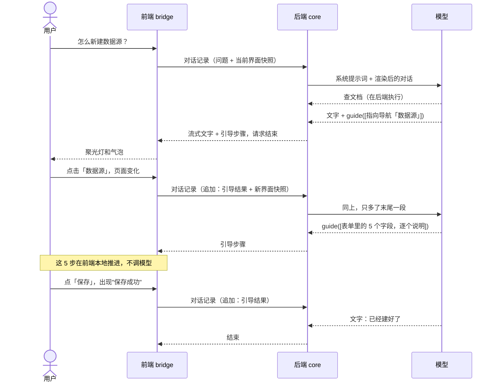

# DocCue 架构设计（v3.0）

> *Turn static docs into context-aware in-app cues.*
>
> **状态**：第 1 至 4 步（换骨架、单屏引导、跨屏引导、文档）已完成，进度见第十一节和 `project_structure.md`。
> v3.0 相对 v2.4 是重写，差异见文末。

## 一、定位

复杂的应用上手慢。文档放在官网，用户得离开应用去查；有些应用做了新手引导，但只能走预先写好的几条路线。

DocCue 是**新手引导的 agent 版**：嵌在应用里，用户问"怎么做 X"或"为什么不行"，它用文字回答，同时在页面上一步步指给用户看。

三条产品原则：

1. **只指不做**。agent 不操控应用，不替用户点击、填写、提交。用户是 agent 的手。
2. **只在被问到时出现**。v1 不做任何主动打扰。
3. **通用组件**。接入只需要前端加一个包、后端挂一个接口；不要求宿主预先打标签或写配置。

### 范围

| | 内容 |
| :--- | :--- |
| **v1 做** | 应用内答疑；单屏和跨屏的可视引导（聚光灯 + 气泡）；产品文档检索；多语言；网页与 Electron / Tauri / WebView 客户端 |
| **以后做** | 按需截图（图表、画布）；预置的首次引导；接入 Skill 与应用地图；主动提示；脱敏；给不擅长工具调用的小模型用的内联指令 |
| **不做** | 登录鉴权、限流、计费；对话的服务端留存与跨设备同步；部署运维；管理后台和可视化编辑器；内置向量检索；原生客户端（Qt、WPF、安卓/iOS 原生） |

"不做"的部分属于宿主自己的系统，DocCue 只留接口。内部也不搭通用插件框架，扩展只靠配置项。

---

## 二、核心机制：引导循环

整个产品是一个工具循环：**模型调用 `guide`，执行者是用户，返回值是"用户做了什么、界面变成了什么样"**。

以用户在首页问"怎么新建数据源"为例：



要点：

- **一次 `guide` 是一段**：模型一次给出当前界面上它能确定的所有步骤，前端本地逐步推进。步骤走完、界面变了或用户走偏时，前端带着新界面回来，模型再给下一段。
- **模型能验证，也能改道**。每一段的结果都回到模型：做成了它会确认；出现报错它看得到，接着指出怎么改。传统引导只管指，不知道用户做成了没有。
- **不需要指的问题直接回答**。"这个字段是什么意思"这类问题，模型只回文字，不调 `guide`。
- **用户随时可以打断**。引导中提问，这一段以"被打断"结束，结果和新问题一起发出；模型答完可以再调 `guide` 接着引导。用户也可以直接退出引导。

---

## 三、总体结构

agent 在后端，但它要用的东西大多在浏览器里（界面、用户的操作、画引导）。后端真正独有的是模型密钥、系统提示词和产品文档。所以：

- **后端无状态**：一个 POST 接口。每次请求收到完整的对话记录，调模型，流式返回。
- **对话记录放在浏览器**：前端保存，每次请求整份带上。
- **循环分两段**：模型与文档之间的循环在后端一次请求内跑完；模型与页面之间的循环由前端驱动，每一段引导是一次新请求。

这和模型 API 本身是同一个形状：模型 API 不记对话，由调用方保存历史、执行工具。浏览器对我们的后端，就像我们的后端对模型 API。

| 前端 `@doccue/bridge`（嵌在宿主页面） | 后端 `@doccue/core`（挂在宿主服务上） |
| :--- | :--- |
| **感知**：记录操作及其后果，生成界面快照 | **渲染**：把对话记录转成给模型的消息 |
| **引导**：找元素、聚光灯、气泡、判断步骤完成、发现走偏 | **循环**：调模型，执行文档工具，遇到页面工具就交给前端 |
| **对话**：保存记录、驱动请求、刷新页面后续上 | **文档**：目录、搜索、阅读 |
| **界面**：自带问答窗（可选） | **模型适配、日志与回放** |

第三个包 `@doccue/protocol` 只有类型，定义两边交换的数据，让前端包不依赖后端包。

两条分工规则：

1. **前端只有数据，没有给模型看的话术**。前端上报结构化数据，渲染成模型读的文字由后端做。提示词格式不会出现在前端，改格式也不用前端发版。
2. **历史只追加**。对话记录里的每一条，每次都渲染成完全相同的文字，已经发给模型的内容从不改动。这样提示词缓存一直命中，Claude 的思考块也保持有效。

这个结构带来的好处：

- 后端可以部署在任何地方，包括无服务器平台；多实例不需要粘性会话或共享存储。
- 取消就是断开请求，不需要取消事件。
- 页面工具在前端本地执行，没有跨网络等结果、按 ID 配对、超时这一套。
- 引导可以等用户几分钟，后端没有任何东西挂着。
- 整页刷新或跳转后，前端从本地记录恢复，接着引导。

代价：

- 对话换设备不延续（宿主需要的话自己存）。
- 后端不能主动推送（以后做主动提示时，由前端本地判定后发起请求）。
- 查到的文档片段和模型的中间步骤会作为对话记录经过浏览器，用户在开发者工具里看得到。系统提示词不经过浏览器。

---

## 四、数据约定（`@doccue/protocol`）

### 1. 定位符

用"角色 + 名字 + 所在区域"指向一个控件，是控件在界面快照之外的持久表示。

```ts
interface Locator {
  role: string;                 // ARIA 角色：button、textbox、link、combobox ...
  name: string;                 // 界面上的名字，保留原文
  within?: Region[];            // 由外到内：弹窗、表格行、分区
  id?: string;                  // 宿主写的 data-cue-id，有就优先用它找
}
interface Region { kind: 'dialog' | 'row' | 'section'; name: string }
```

感知时，前端把元素描述成定位符；引导时，前端把定位符找回元素。两者用同一套命名规则，是同一件事的正反两面。

### 2. 界面快照

```ts
interface Screen {
  page: { path: string; title?: string };
  nodes: ScreenNode[];
  truncated?: number;           // 因超出上限没有列出的节点数
}
interface ScreenNode {
  ref?: number;                 // 编号。控件、标题、分组有；纯文字没有
  role: string;                 // 控件用 ARIA 角色；另有 heading、dialog、form、table、row、
                                // navigation、group、text、alert（报错）、status（提示）
  name?: string;
  value?: string;               // 输入框的当前值、下拉框的选中项。密码框不带
  states?: string[];            // disabled、checked、invalid、expanded、current ...
  children?: ScreenNode[];
}
```

后端渲染给模型时是这样：

```text
page "新建数据源" /datasource/new
[1] heading "新建数据源"
[2] form "连接信息"
  [3] textbox "主机地址" = "http://127.0.0.1:5432" (invalid)
  alert "Invalid Host Format"
  [4] textbox "端口" = "5432"
  [5] button "测试连接"
  [6] button "保存" (disabled)
```

**模型用编号指向控件**，所以只能指它确实见过的东西，不会编造。当前还留在界面上的报错就是快照里的 `alert` 节点和 `invalid` 状态，不另外上报。

### 3. 操作记录

```ts
interface TimelineEntry {
  at: number;
  action?: {                    // 没有 action 的条目表示页面自己发生的事
    type: 'click' | 'input' | 'select' | 'check' | 'uncheck' | 'submit';
    target?: Locator;
    value?: string;             // 输入框的最终值。密码框不带
  };
  effects?: Effect[];           // 这个操作引起的后果
}
type Effect =
  | { type: 'error'; text: string; target?: Locator }
  | { type: 'notice'; text: string }
  | { type: 'dialog'; state: 'opened' | 'closed'; name: string }
  | { type: 'navigate'; page: { path: string; title?: string } }
  | { type: 'request_failed'; method: string; path: string; status?: number; message?: string }
  | { type: 'script_error'; message: string };
```

操作和后果配对是排查问题最有用的信息：每个操作之后观察一小段时间，把它引起的报错、提示、弹窗、跳转、接口失败挂在它后面。页面跳转总是作为后果记录：由点击引起的挂在那次点击后面，其余的（浏览器后退、直接改地址）单独成一条。

### 4. 感知数据

每次上传的现场信息：

```ts
interface Perception {
  at: number;
  screen: Screen;
  actions: TimelineEntry[];     // 上次上传之后的操作
}
```

### 5. 引导

`guide` 工具的参数和结果：

```ts
interface GuideStep {
  target: number | Locator;     // 模型用编号；预置引导用定位符
  text: string;                 // 气泡里的说明
  expect?: 'click' | 'input' | 'select' | 'ack';   // 这一步怎样算完成；不写则按角色推断
}
interface GuideResult {
  outcome: 'completed' | 'deviated' | 'not_found' | 'interrupted' | 'exited';
  completedSteps: number;       // 走过了几步，做了的和跳过的都算
  skippedSteps?: number[];      // 用户点"下一步"跳过、没有操作目标的步骤（从 1 数）
  perception: Perception;       // 这一段期间的操作 + 结束时的界面
}
```

| `outcome` | 含义 | 之后 |
| :--- | :--- | :--- |
| `completed` | 所有步骤走完 | 自动发下一次请求 |
| `deviated` | 用户做了别的事，当前目标消失了（去了别的页面、关了弹窗） | 自动发下一次请求，模型改道 |
| `not_found` | 某一步的目标找不到 | 自动发下一次请求，模型按新界面重新指 |
| `interrupted` | 用户在引导中提了新问题 | 随新问题一起发出 |
| `exited` | 用户关掉了引导 | 不发请求，只记入对话 |

`expect: 'ack'` 表示用户点气泡上的"下一步"才算完成，用于纯介绍的步骤（"这里是仪表盘"）。其余步骤，用户对目标做了任何操作（点击、填写、选择）就算完成；也可以点"下一步"跳过，跳过的步骤会在结果里注明，模型不会再引导一遍。

### 6. 对话记录

```ts
type Item =
  | { type: 'user'; text: string; perception: Perception }
  | { type: 'model'; messages: unknown[] }                        // 后端这次请求追加的消息，原样保存
  | { type: 'guide_result'; callId: string; result: GuideResult };
```

`model` 条目对前端是不透明的：里面有助手的回答、思考块、文档工具的调用和结果。前端不解析，下次请求原样发回。

### 7. 请求与返回

```text
POST {base}/turn
{ "v": 1, "conversation": Item[], "locale": "zh-CN", "user": { ... } }
```

返回是这次请求的事件流（`text/event-stream`）：

```ts
type StreamEvent =
  | { type: 'status'; state: 'thinking' | 'tool'; tool?: string }
  | { type: 'text'; delta: string }
  | { type: 'guide'; callId: string; steps: GuideStep[] }
  // 总是最后一条。item 是要追加到记录里的 model 条目
  | { type: 'end'; reason: EndReason; item: Item; usage: Usage; error?: { message: string; code?: string } };

// guide：模型发起了一段引导（见 guide 事件），前端执行后把结果随下一次请求发回
type EndReason = 'completed' | 'guide' | 'max_steps' | 'max_tokens' | 'refusal' | 'aborted' | 'timeout' | 'error';
```

- 取消：前端断开请求。被取消的这次输出不进入对话记录。
- 校验：后端对请求逐层做结构校验（`model` 条目里的消息、界面树、操作、引导结果都查到底），结构不对的直接以 400 拒绝并指出字段；大小限制（条目数、文本长度、快照大小）留到后续。
- 信任：请求体全部来自浏览器，`model` 条目也只是前端存着再发回来，只能查结构、不能防改写，所以整份对话和用户自己打的字同等看待。`user` 属性由宿主在 `createHandler` 的 `user` 里从服务端会话取，覆盖浏览器发来的那份。渲染时会打断文本里形如 `<context>` / `</context>` 的标签，页面上的文字和问题都没法关掉或伪造现场信息块。

---

## 五、前端（`@doccue/bridge`）

### 1. 感知

做法参考无埋点分析 SDK：不改业务代码，自动记录。区别是它们记下来给人看报表，这里整理成给模型读的数据。

**记录操作**

- 记：点击可操作的控件；输入框的最终值（失焦或提交时记一次）；勾选、下拉选择；表单提交；页面跳转（history API、popstate、hashchange）。
- 不记：鼠标移动、悬停、滚动、每次按键、点在空白处；`type="password"` 的值；`data-cue-ignore` 区域里的一切（DocCue 自己的界面也在其中）。
- 后果：每个操作之后的观察窗口内（默认 1 秒），用 MutationObserver 发现新出现的报错、提示、弹窗；包装 `fetch` / `XMLHttpRequest` 记录失败请求的方法、路径、状态码和服务端消息；监听 `error` / `unhandledrejection`。接口采集可以关闭。
- 存放：只在浏览器本地（sessionStorage，保留最近若干条），提问或引导回传时才上传。

**给控件命名**

像读屏器那样取名，依次尝试：`aria-labelledby` → `aria-label` → 关联的 `<label>` → 按钮或链接上的文字 → `placeholder` → `title` / `alt` → `name` 属性。

- 从事件目标往上找最近的可操作元素；Shadow DOM 里用 `composedPath()`。
- 同名控件带上所在区域：弹窗标题、表格行的关键文字、最近的标题。
- 宿主写了 `data-cue-id` 时放进定位符的 `id`。它是身份而不是名字：命名仍用界面上的文字，找元素时优先用它。

**生成界面快照**

遍历当前可见的界面，保留标题、分组、控件（带当前值和状态）、报错、提示、短文字；去掉隐藏元素、装饰和纯布局容器。大小有上限，超出时优先保留弹窗和可见区域内的内容，并注明省略了多少。

报错文字的识别：`[data-cue-error]`、`[role="alert"]`，以及常见 UI 库的报错类名（Ant Design、Element Plus、MUI、Bootstrap）；宿主可以追加选择器。`aria-invalid="true"` 的控件在快照里带 `invalid` 状态。

### 2. 定位

- 生成快照时，前端记下每个编号对应的元素和它的定位符。
- 收到引导步骤后，立刻把编号换成"元素引用 + 定位符"。元素还在就直接用；页面重绘后引用失效，就用定位符重新找。
- 目标暂时不存在时等一小段时间（控件可能正在渲染），仍找不到才报 `not_found`。
- 目标在可见区域之外时先滚动到可见。

### 3. 引导运行

- **渲染**：聚光灯（目标之外压暗）和气泡（说明文字、步骤进度、"跳过"和"退出"），放在一个 Shadow DOM 层里，带 `data-cue-ignore`。遮罩不拦截点击，用户随时可以操作页面任何地方。
- **跟随**：目标移动、页面滚动、窗口缩放时，聚光灯和气泡跟着走。
- **推进**：步骤是否完成，由感知模块的同一套操作记录判断：用户对目标做了操作（点击、填写、选择），或点了"下一步"。
- **提前做了后面的步骤**：用户操作的是后面某一步的目标时，引导直接跳到那一步之后，中间没做的步骤记为跳过。
- **走偏**：当前目标消失且不是因为这一步完成（去了别的页面、关了弹窗），等一小段时间仍不出现，这一段以 `deviated` 结束。
- **段结束**：等页面稳定再生成新快照。稳定的判定是：页面自己发出的请求都已返回，且 DOM 连续 300 毫秒没有变化；最多等 4 秒。然后按上表决定是否发下一次请求。
- **恢复**：当前这一段的步骤、每一步的定位符和进度存在 sessionStorage。整页刷新或跳转后，新页面上的 bridge 接着做：
  - 引导还没走完：按定位符重新找到目标，从原来那一步继续。
  - 最后一步的操作本身引起了页面跳转：把这一段记为完成，带着新页面的快照发下一次请求。
  - 请求发出后、回答回来前页面没了：把那次请求重发一遍。

### 4. 对话

- 记录存在 sessionStorage，每个标签页一份。
- 驱动：提问 → 发请求 → 收流 → 有 `guide` 就执行 → 把结果追加进记录 → 需要时再发请求，直到模型不再调用 `guide`。
- 每个问题能连续引导的段数有上限（默认 20），防止无限循环。
- `state` 事件和 `busy()` 告诉宿主 bridge 是否正忙（回答在路上，或引导在屏幕上），页面刷新后恢复的那一轮也算。
- 回答进行中的新提问：断开当前请求，带着新问题重发。
- 记录有长度上限。到上限时提示开始新对话；自动总结后续接以后再做。

### 5. 界面

- 自带一个问答窗（Shadow DOM，按需懒加载）。引导进行时它收成一个小条，不挡住页面。
- 不想用自带界面的宿主可以只用接口，自己做问答框。
- 文案走语言包。

### 6. 接入

```ts
import { createBridge } from '@doccue/bridge';

const cue = createBridge({ endpoint: '/doccue', locale: 'zh-CN' });   // 从这一行开始记录操作
cue.mount();                        // 挂上自带的问答窗

// 或者自己做界面：
cue.on('text', (event) => { ... });   // event.delta
cue.on('end', (event) => { ... });    // event.reason
cue.on('guide_end', (event) => { ... });   // 一段引导结束：event.outcome
await cue.ask('怎么新建数据源？');
cue.stop();                         // 取消当前回答或退出引导
cue.reset();                        // 开始新对话
```

---

## 六、后端（`@doccue/core`）

### 1. 接口

`createHandler()` 返回一个标准的 `(Request) => Promise<Response>`，可以挂在任何支持 Fetch API 的运行时上；另附 Node / Express / Connect 的适配。鉴权、限流由宿主套在外面。

```ts
import { createHandler, createAnthropic } from '@doccue/core';
import { markdownDocs, toNodeHandler } from '@doccue/core/node';

const handler = createHandler({
  model: createAnthropic({ apiKey, model }),
  instructions: '你是「数据平台」的应用内助手 ...',
  docs: await markdownDocs('./docs'),
});
app.use('/doccue', toNodeHandler(handler));
```

### 2. 渲染

把对话记录转成模型消息。规则固定，同一条记录每次渲染结果相同：

- **系统提示词**：宿主的 `instructions` + 固定的使用说明（英文）+ 文档目录。所有用户共用同一份，方便缓存；用户的语言和属性不放在这里。
- **`user` 条目**：一条用户消息，现场信息在前，问题在后。用户的语言和属性只写在第一条里。
- **`model` 条目**：原样放回。
- **`guide_result` 条目**：`guide` 的工具结果，写明结果、这一段里的操作、新的界面快照。

现场信息的样子：

```text
<context locale="zh-CN">
user: role=新用户, plan=试用版
recent actions:
5s ago: input textbox "主机地址" = "http://127.0.0.1:5432"
2s ago: click button "测试连接" -> error "Invalid Host Format" on textbox "主机地址"
screen:
page "新建数据源" /datasource/new
[1] heading "新建数据源"
...
</context>
为什么连不上？
```

操作的时间写成"距这次上传多久之前"，不依赖时区。

连续重复的操作折叠成一条并注明次数。

### 3. 循环

一次请求内：调模型 → 执行它要的工具 → 把结果追加 → 再调模型，直到模型给出回答或调用了页面工具。

- 工具分两种：**后端工具**（文档、宿主自定义的工具）在后端执行；**页面工具**（v1 只有 `guide`）不在后端执行，循环到此停下，把调用交给前端。
- 同一步里两种都有时，后端先执行后端工具，结果随记录返回；页面工具的结果由前端在下次请求补齐。
- 一步里只交出一个页面工具调用，多出来的退回模型。
- 参数不对的调用不交给前端，像普通工具错误一样退回模型重试。`guide` 指向最新界面里不存在的编号也算参数不对。
- 最大步数、单次请求超时、中止。
- 输出被截断、模型拒答、模型报错，都以明确的结束原因返回。

### 4. 工具

| 工具 | 在哪执行 | 作用 |
| :--- | :--- | :--- |
| `guide(steps)` | 页面 | 在页面上引导用户，返回用户做了什么和新的界面 |
| `search_docs(query)` | 后端 | 搜索产品文档 |
| `read_doc(id)` | 后端 | 阅读一篇文档或其中一节 |
| 宿主自定义 | 后端 | 通过配置追加 |

v1 没有 `get_screen` / `get_timeline` 这类按需查看的工具：引导本来就需要界面，快照直接随问题和引导结果给模型。

### 5. 文档

```ts
interface DocsProvider {
  toc(): string;                                   // 目录，放进系统提示词；每次请求要一样
  search(query: string): Promise<DocHit[]>;        // { id, title, snippet }
  read(id: string): Promise<string | undefined>;   // 一节全文，含它的小节
  inline?(): string | undefined;                   // 文档够小时的全文，放进系统提示词代替工具
}
```

- **默认实现**：`createDocs(files)` 在主入口，任何运行时都能用；`markdownDocs(dir)` 在 `@doccue/core/node`，读一个目录下的全部 Markdown（含子目录），启动时读一次。
- **切分**：按标题切成小节，代码块里的 `#` 不算标题；第一个标题之前的文字归到以文件名命名的一节。每节的 ID 是"文件路径#标题"，同名的加序号。目录列出三级以内的标题和 ID。
- **检索**：关键词打分，不用向量库。中文、日文、韩文按相邻两个字切分，其余按单词；标题里命中的权重是正文的 3 倍，越少见的词权重越高。返回前 5 节，每节带 ID、所在位置（如"新建数据源 › 端口"）和命中处附近约 200 字。
- **小文档整份进提示词**：全文不超过阈值（默认 12000 字符）时整份放进系统提示词，不提供检索工具，这是效果最好也最简单的做法。宿主可以把阈值设为 0，始终走检索。
- **提示词**：要求模型遇到关于产品怎么用的问题（字段含义、规则和限制、怎么做、报错是什么意思）先查文档再回答，不要猜；文档和界面不一致时以界面为准。
- **自定义实现**：宿主可以传入自己的 `DocsProvider`，接已有的搜索服务。

### 6. 模型

保留现有的两个适配器，运行时零依赖，直接用原生 `fetch`：`createAnthropic`（Claude，官方接口或中转）和 `createOpenAI`（OpenAI 及所有兼容接口，含本地模型）。统一成一种流式输出；支持中止、空闲超时、还没输出时的自动重试。

### 7. 日志与回放

每次请求记录：收到的对话记录、发给模型的完整内容、模型的返回、首字和总耗时。可以把日志里的某一次模型调用原样重发，对比前后回答。后端无状态之后，一条日志就是一次请求的全部输入，回放更直接。

---

## 七、多语言

靠分工解决，不需要翻译表：

| 内容 | 语言 |
| :--- | :--- |
| 前端上报的数据 | 结构化；角色和操作类型用固定的英文词，名字和文字保留界面原文 |
| 后端给模型的框架文字（系统提示词里的说明、现场信息的格式） | 固定英文 |
| 模型的回答、气泡里的说明 | 跟随用户的语言（由 `locale` 和用户的提问决定） |
| 自带问答窗的按钮和提示 | 语言包 |
| 宿主的 `instructions` 和产品文档 | 宿主决定 |

---

## 八、安全与隐私

- **不操控带来的上限**：页面上的内容（包括其他用户生成的内容）会进入模型的上下文，可能带有诱导性文字。因为 agent 不能操作应用，最坏的后果是指错控件或说错话。
- **气泡和回答按文本渲染**，不执行其中的任何标记。
- **接口是开放的**：谁能访问它，谁就能让它调模型。鉴权和限流必须由宿主加；DocCue 负责请求大小和结构的上限。
- **对话记录由客户端持有**，用户可以篡改自己发上来的内容。这不比界面数据本来就由前端上报更糟；系统提示词始终由后端注入。需要时可以让后端给 `model` 条目签名、拒收被改过的记录（以后做）。
- **采集的边界**：输入框的值会上传并进入模型上下文。密码框的值从不采集；宿主可以用 `data-cue-ignore` 把敏感区域整块排除。更细的脱敏以后做。

---

## 九、风险与对策

| 风险 | 对策 |
| :--- | :--- |
| **换屏等待**：每换一个界面要等模型给下一段，大约 1 到 3 秒 | 模型一次给出当前界面上的所有步骤；历史只追加，提示词缓存命中；尽快判定页面稳定；等待时气泡显示加载状态。以后有了应用地图，模型可以用定位符一次给出跨屏的步骤 |
| **复杂页面的快照太大** | 设上限；优先保留弹窗和可见区域；长列表只保留前几行并注明总数 |
| **控件命名不准**（只有图标的按钮、用 div 拼的控件） | 退回用附近文字和所在区域命名；用评测场景持续衡量；以后由接入 Skill 补 `aria-label` / `data-cue-id` |
| **界面在引导途中变化** | 定位符重新找；找不到就以 `not_found` 回到模型，按新界面重新指 |
| **模型不了解没见过的页面** | v1 靠文档和当前界面，走一屏看一屏；以后加应用地图 |

---

## 十、评测

控件指得准不准决定产品质量，所以从做引导开始就建评测场景，改提示词、改快照格式或换模型时跑一遍：

- **单步场景**：一个固定页面 + 一个问题 → 第一步应该指向哪个控件。用真实模型跑，统计命中率。已有 7 个（`apps/evals`，`pnpm eval`），覆盖中英文界面、报错字段、导航、表格行、只有图标的按钮、标签页、弹窗，以及不该引导的问题。
- **多步场景**：在 playground 里用浏览器自动化扮演用户，聚光灯指到哪就操作哪（点按钮和链接，按场景给的值填写），检查能否走到目标状态。已有 3 个（`apps/playground/e2e/journeys.ts`，`pnpm journeys`）：跨页面新建数据源、经过确认弹窗删除数据源、中途整页刷新后继续。

测试不用假模型：涉及模型行为的测试都调真实模型，前端的测试在 playground 上用真实浏览器跑。真实模型无法按需触发的情况（限流和过载时的重试、拒答、坏掉的工具参数、流中途断开），用接口原始响应样本喂给真实的适配器代码来测。不涉及模型的部分（命名、记录、快照、定位、引导浮层、渲染）在模拟 DOM 或纯函数层面测。

---

## 十一、实施顺序

1. **换骨架** ✅。协议包、无状态接口、前端对话驱动、结构化感知与后端渲染。答疑能力与重构前持平，已在真实浏览器 + 真实模型上验证。首轮只做了主干，暂未处理：请求的大小上限与裁剪、对话记录的长度上限、请求体大小限制。
2. **单屏引导** ✅。定位、聚光灯和气泡、步骤推进、`guide` 工具、单步评测场景。在 playground 里问"为什么连不上"，agent 说明原因、指向出错的输入框，用户改完并重新测试后，它确认连上并停下；已在真实浏览器 + 真实模型上验证。首轮暂未处理：气泡避开相邻内容（现在只在目标的下方或上方）。
3. **跨屏引导** ✅。段结束后续接、整页刷新后恢复、提前做了后面步骤时跳过去、页面稳定的判定、多步评测场景。从仪表盘说"我想新建一个 MySQL 数据源"，被引导着点导航、填表单、测试、保存，模型看到列表里出现新数据源后确认完成；3 个多步场景在真实浏览器 + 真实模型上全部通过。首轮暂未处理：指向分组（表单、导航这类没有定位符的节点）的步骤在刷新后找不回，会以找不到目标回到模型；恢复的那一轮请求失败时，宿主只收到"不忙了"，没有错误事件；真正的多页应用没有专门测，playground 是单页应用，用整页刷新模拟。
4. **文档** ✅。`createDocs` / `markdownDocs`、`search_docs` / `read_doc`、小文档整份进提示词。playground 的产品知识已从 `instructions` 挪进一套模拟文档（`apps/playground/docs/`），用户问"删除后能恢复吗""连接失败是什么原因"，agent 查文档后按文档回答；已用真实模型验证两种模式。首轮暂未处理：检索只是关键词匹配，没有同义词和词形变化；很长的一节读出来不截断；文档很多时目录本身会很长；文档之间的链接不解析。
5. **自带问答窗**与语言包。

### 现有代码的去留

| 现有代码 | 处理 |
| :--- | :--- |
| `core/model`（适配器、流式解析、重试、错误） | 保留 |
| `core/loop`（核心循环） | 保留，增加"页面工具交给前端" |
| `core/log`（日志与回放） | 保留，改成按请求记录 |
| `core/protocol`（输入校验） | 按新约定重写 |
| `core/context`（状态栏） | 改写成新的渲染模块 |
| `core/server`（POST 事件 + SSE 订阅） | 改写成单个 POST 接口 |
| `core/scheduler`、`core/state`（事件队列、服务端会话） | 删除 |
| `bridge` 的命名、记录、界面树、报错采集 | 保留做法，输出改成结构化数据 |
| `bridge/client`（EventSource） | 改写成对话驱动 |
| `apps/playground` | 保留，接到新接口上 |

---

## 附：v3.0 相对 v2.4 的变更

- **定位收窄**：新手引导的 agent 版。只指不做，去掉一键代填；v1 只做被动，去掉主动提示和自动弹出的首次引导。
- **后端无状态**：对话记录放在浏览器，一个 POST 接口。去掉服务端会话、事件队列和 SSE 长连接。
- **引导是一个工具循环**：高亮、代填、开始引导三种指令合并成 `guide`，结果回到模型。
- **去掉渐进式披露的按需查看工具**：界面快照直接随问题和引导结果给模型；状态栏改为随每个问题附带的现场信息。
- **结构化、与语言无关的感知数据**：前端不再上报拼好的中文字符串；模型用快照编号指向控件，定位符作为持久表示。
- **`data-cue-id`** 从"命名的第一优先"改为"找元素的第一优先"，命名仍用界面上的文字。
- **新增** `@doccue/protocol` 包；文档检索先作为 `core` 里的模块，不单独成包。
- **新增**评测场景。
